# Вартовий Світла

**Твій персональний контроль електропостачання.**
Графіки відключень ДТЕК за твоєю чергою, сповіщення та статистика — в одному
застосунку для Android.

  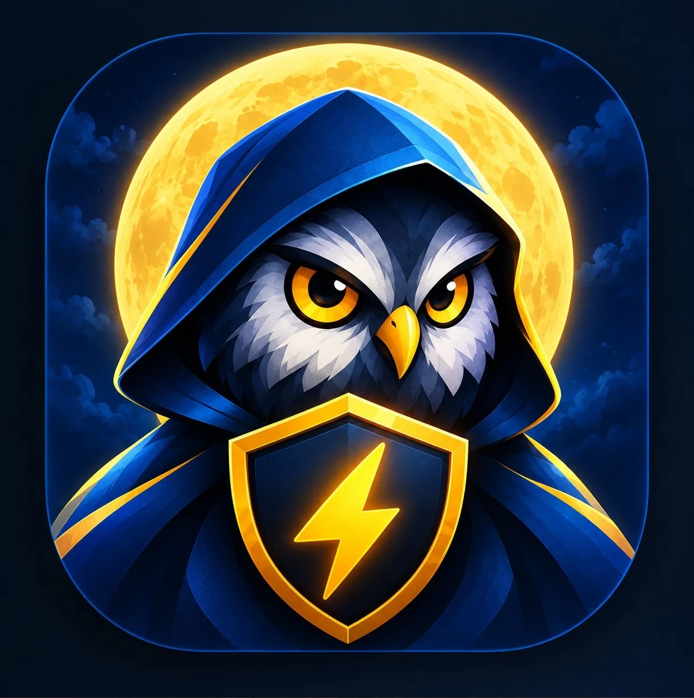

<b>Скріншоти</b>

<b>Темна тема</b>

  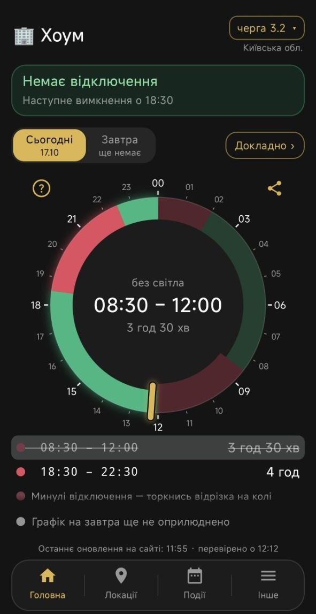
  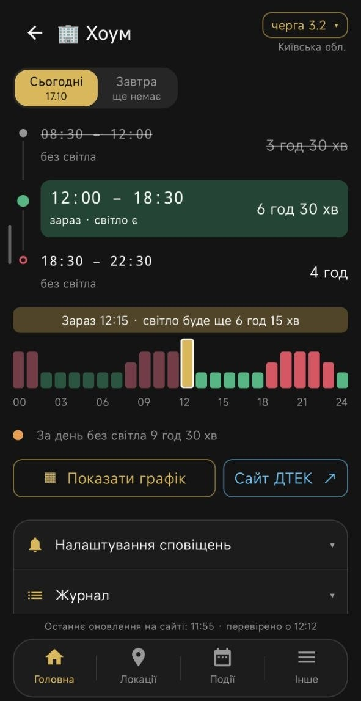
  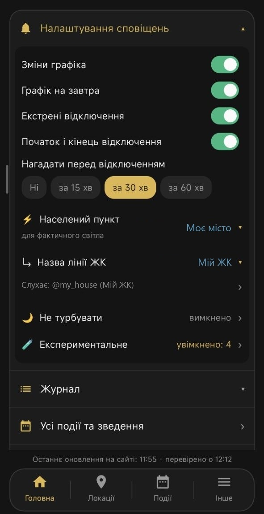

  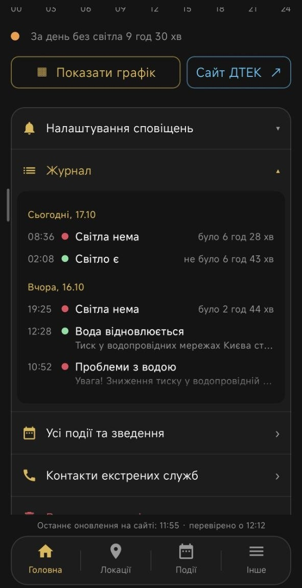
  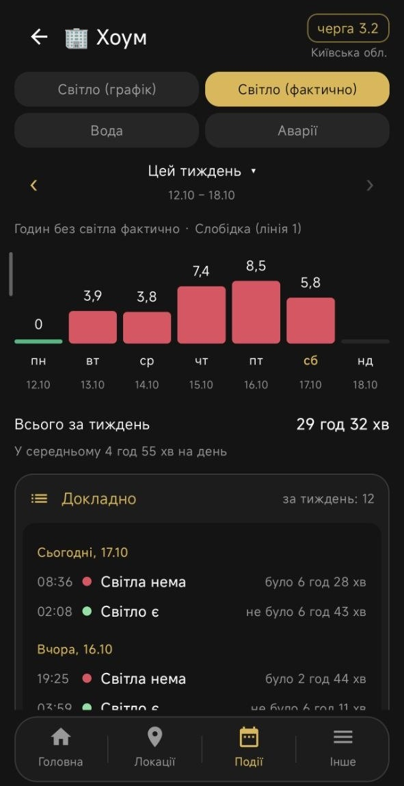
  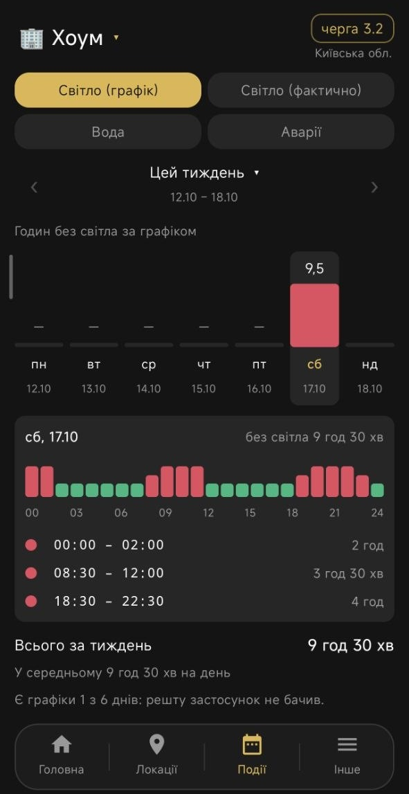

  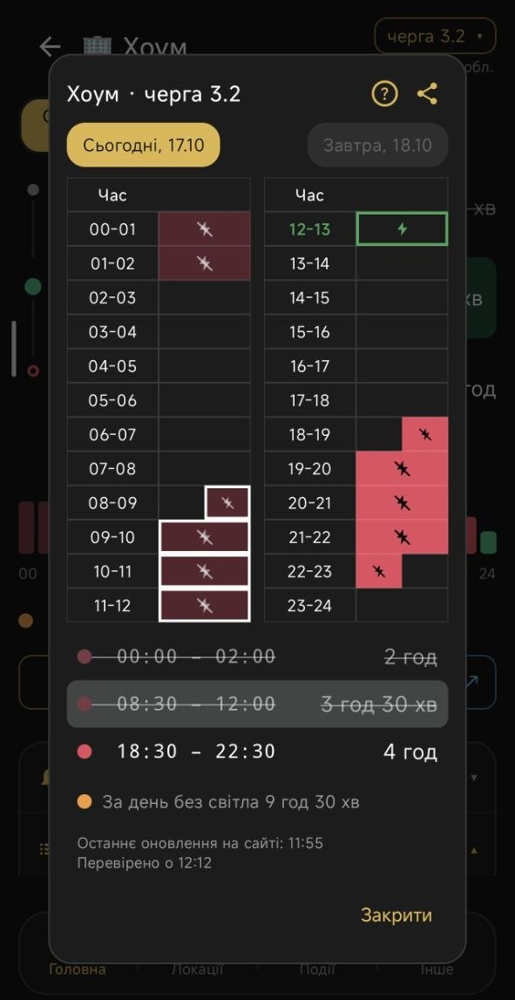
  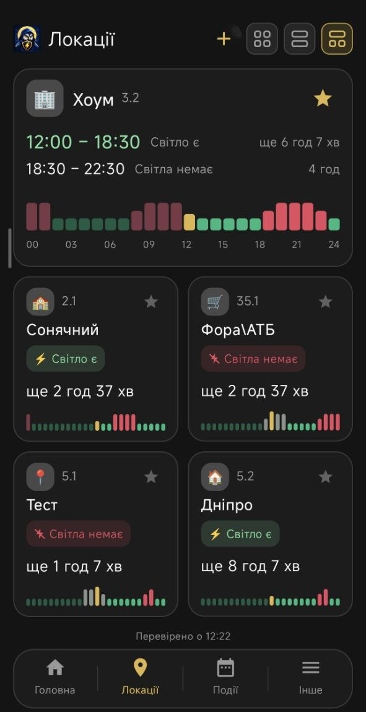
  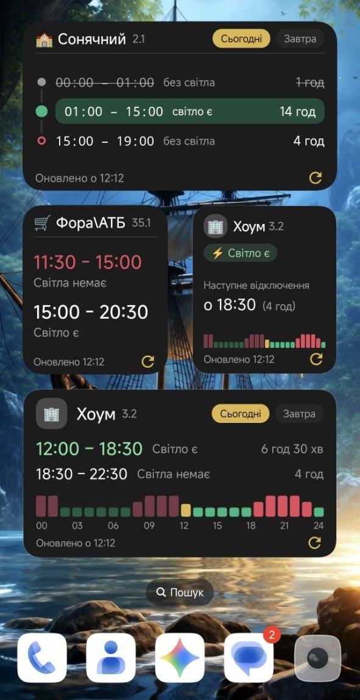

<b>Світла тема</b>

  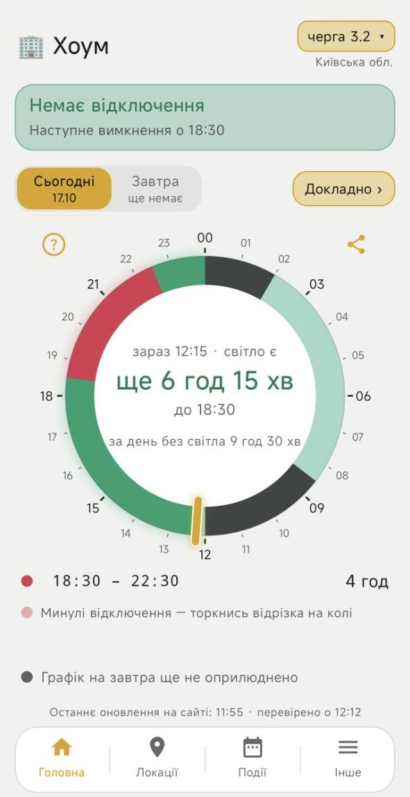
  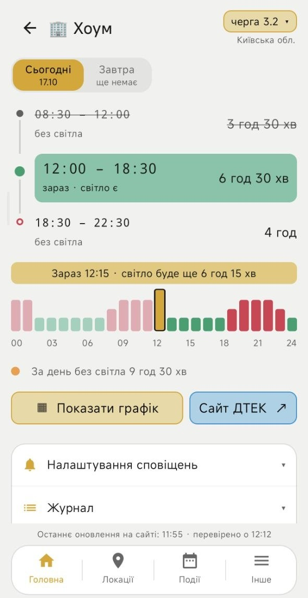
  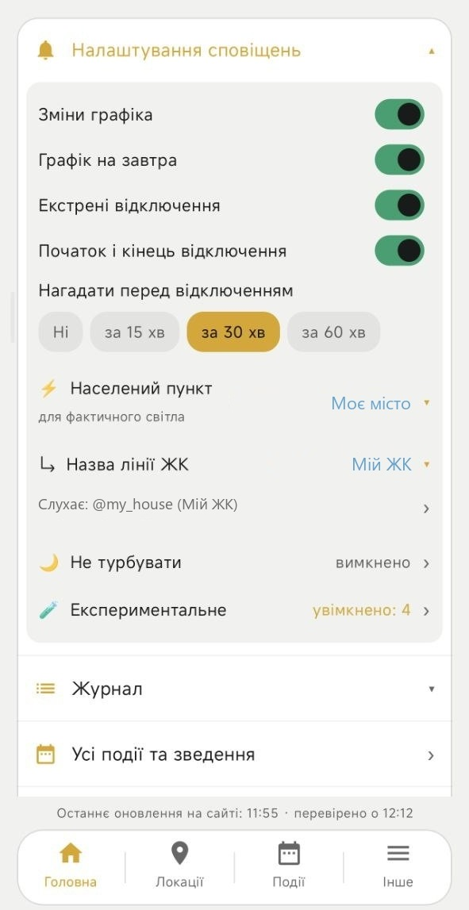

  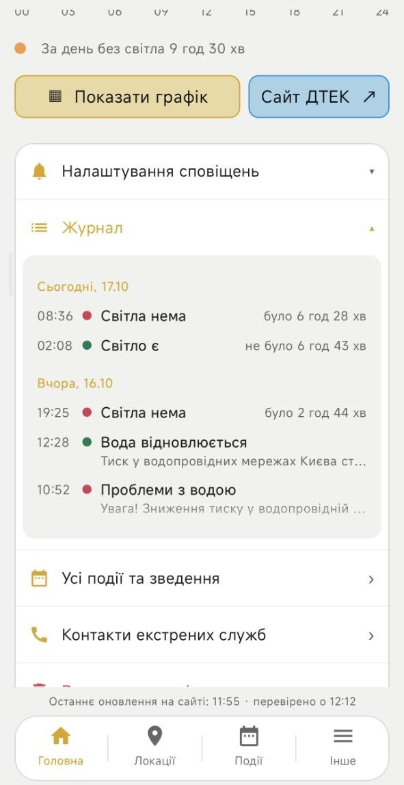
  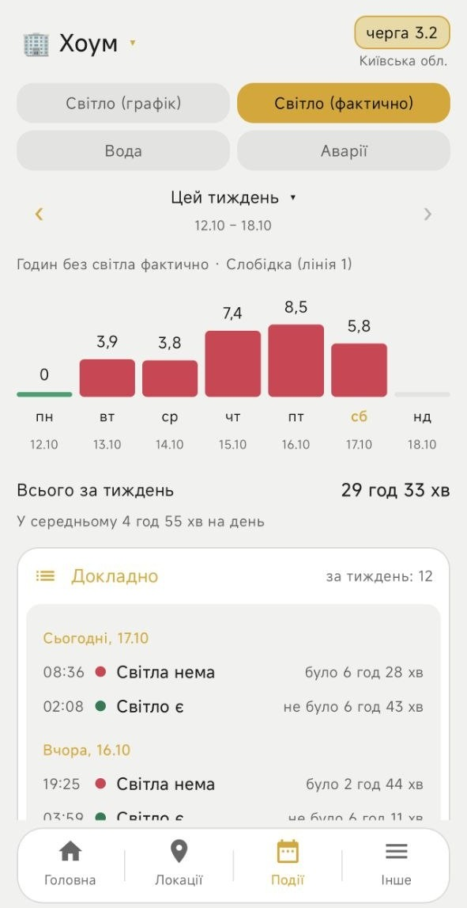
  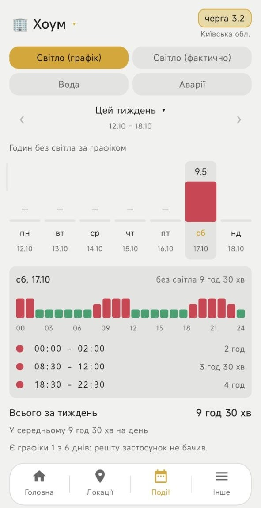

  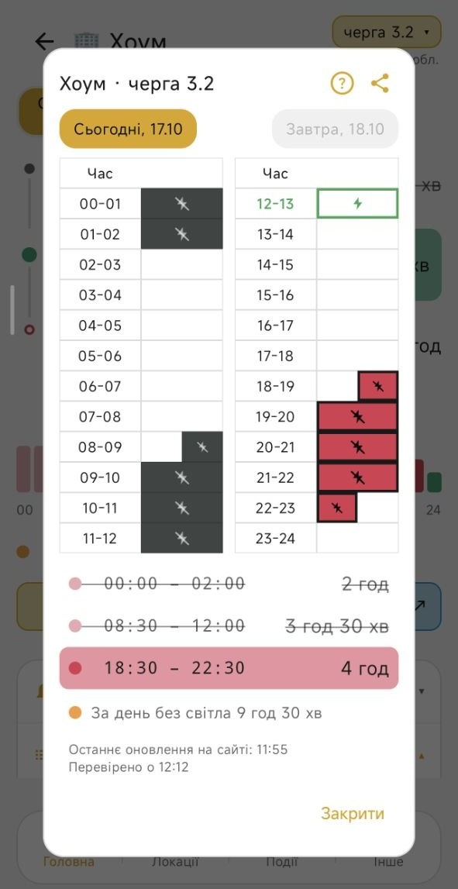
  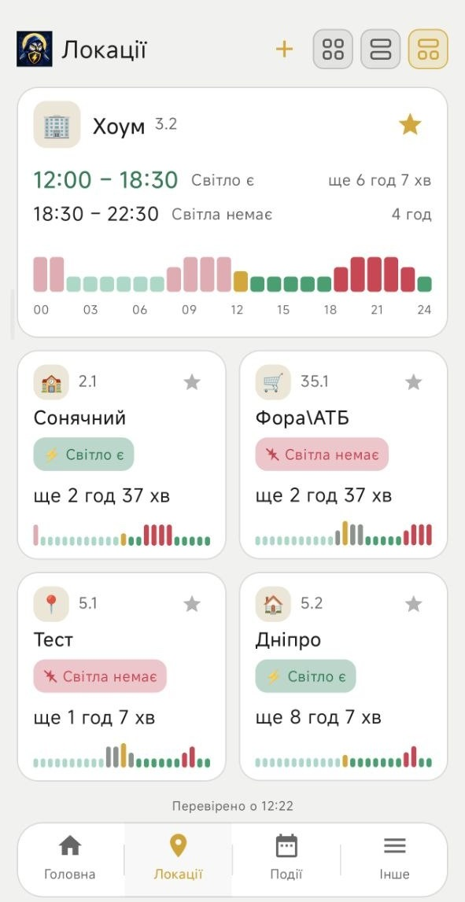
  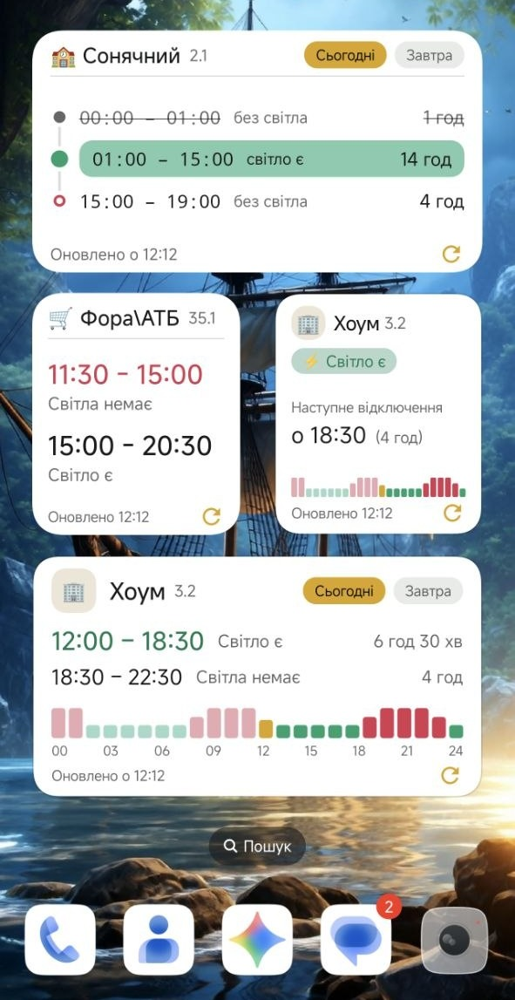

Регіони: м. Київ, Київська, Дніпропетровська та Одеська області.

## Можливості

- **Циферблат доби.** Одразу видно, чи є світло, скільки ще лишилося і що буде
  далі — сьогодні й завтра.
- **Кілька локацій.** Дім, робота, батьки — кожна зі своєю чергою, значком і
  власними сповіщеннями.
- **Сповіщення.** Новий графік і графік на завтра, зміни, нагадування перед
  відключенням, початок і кінець відключення. Тихі години — щоб не будило вночі.
- **Події та зведення.** Скільки годин без світла було щодня — за графіком і
  фактично, — проблеми з водою й аварії, за тиждень чи будь-який період.
- **Фактичне світло.** Повідомлення СвітлоБотів та каналів будинків: коли світло
  справді зникло й коли з'явилося. Свій канал можна додати за хвилину.
- **Екстрені відключення, аварії та вода** — з Telegram-каналів ДТЕК і
  водоканалів (експериментально).
- **Віджети** кількох видів — від мінімалістичних до карток, з перебігом доби.
- **Контакти служб** — ДТЕК, водоканали, ЖЕК, інтернет-провайдери — під рукою.
- **Світла й темна тема**, поділитися графіком картинкою, лог для автора.

Усе, що застосунок каже за графіком, — це графік: розетку він не бачить.
Фактичний стан — лише там, де є СвітлоБот або канал будинку.

## Звідки дані

- Графіки — з відкритого репозиторію
  [Baskerville42/outage-data-ua](https://github.com/Baskerville42/outage-data-ua).
- Експериментальні джерела — відкриті сторінки Telegram-каналів і новини
  Київводоканалу; вмикаються окремо в налаштуваннях.

Жодних облікових записів, реклами чи збирання даних.

## Встановлення

Завантаж `.apk` зі сторінки
[Releases](https://github.com/sotik11/vartovyi-svitla-app/releases) і відкрий його на
телефоні — Android попросить дозволити встановлення з цього джерела.

Щоб сповіщення не запізнювались, дозволь застосунку працювати у фоні без
обмежень батареї: він сам підкаже, якщо це потрібно.

Що нового — у [списку змін](CHANGELOG.md).

## Зворотний зв'язок

Ідеї, помилки, побажання — у Telegram-бот
[@svitloAnother_bot](https://t.me/svitloAnother_bot).
